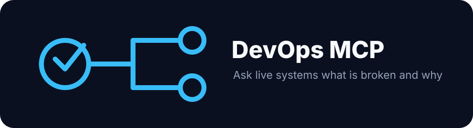

# devops-mcp




> Ask Claude "Why is production down?" and get a real answer from your live systems.

MCP server that connects Claude to your DevOps stack. Query Kubernetes, Jenkins, GitHub Actions, AWS, Azure, GCP, ServiceNow, Slack, and Microsoft Teams in plain English, without switching tabs or terminals.

Built this after watching on-call engineers spend 25 minutes hunting across six dashboards to understand a single incident.


## Why this exists

Chat assistants cannot see the systems on-call engineers actually use, so incident triage means copy-pasting between dashboards. devops-mcp gives Claude read access to those systems through one MCP server, with the guardrails an operations team needs before it will let a model near production.

## Why not just ask an AI to write this

A first draft of "wrap the Kubernetes API in an MCP tool" is easy. The parts that make it safe to run against production are not, and each one is tested here:

- **It never invents data.** An unconfigured service returns a plain "not configured" error. Sample data is opt-in (`DEVOPS_MCP_DEMO=1`) and every response is labelled, so an assistant cannot report a made-up OOMKill or a Slack message that was never sent.
- **It finds the failures that matter.** A crash-looping pod reports phase `Running`; the reason sits on the container state. The pod check reads container waiting and terminated reasons, so CrashLoopBackOff and ImagePullBackOff are caught, not just `Pending`.
- **Read-only by design.** No tool applies, deletes, restarts or triggers anything. The only writes are Slack and Teams messages.
- **Prompt-injection aware.** A webhook URL supplied by the model must be an https Microsoft endpoint, so injected text in a log line cannot make the server POST channel content to an arbitrary host.
- **A private audit trail.** Every tool call is logged as one JSON line in `~/.devops-mcp/audit.log` (mode 0600, rotated at 10 MB). Secret-like parameters are redacted, and a logging failure never breaks a tool.
- **Bounded output.** Pod logs are capped by lines and bytes, and Jenkins console logs are streamed so a multi-hundred-MB build log cannot exhaust memory.
- **Partial installs work.** Each integration loads on its own; one broken module never stops the rest.

---

## What it looks like in practice

```
You: "The API deployment has been stuck for 20 minutes. What's going on?"

Claude:
  [k8s_get_deployment_status("api-server", "production")]
  → desired: 3  ready: 1  updated: 3  strategy: RollingUpdate

  [k8s_get_failing_pods("production")]
  → api-server-7d9f8b-xk2p9  CrashLoopBackOff  restarts: 14
  → api-server-4k8m3-rz9q1   CrashLoopBackOff  restarts: 11

  [k8s_pod_logs("api-server-7d9f8b-xk2p9", tail_lines=30)]
  → [09:10:03] FATAL  postgresql://db-prod:5432: Connection refused

  [k8s_get_events("production", event_type="Warning")]
  → OOMKilling  Pod/db-prod-0  "Memory limit exceeded"  count: 3

  Root cause: db-prod-0 was OOMKilled at 09:09:47. The API pods are
  crash-looping because the database stopped accepting connections.
  INC0045231 is already open and assigned to oncall-sre.
  Fix: raise db-prod memory limit 512Mi → 1Gi.
```

---

## Architecture

> See [docs/architecture.md](docs/architecture.md) for the full protocol flow, tool registration, and audit logging diagrams.

```
+-----------------------------------------------------------------------+
|                           Claude (LLM)                                |
|   "Why is production down?" / "Which jobs are failing right now?"     |
+-----------------------------------+-----------------------------------+
                                    |  MCP Protocol (stdio)
                                    v
+-----------------------------------------------------------------------+
|                          devops-mcp server                            |
|                                                                       |
|  Kubernetes  |  Jenkins/GHA  |  AWS           |  Azure               |
|  pods/events |  build logs   |  CW logs       |  Monitor/AKS         |
|  deployment  |  failing jobs |  metrics/ECS   |  resource health     |
|              |               |                |                      |
|  GCP         |  ServiceNow   |  Slack         |  Teams               |
|  Cloud Logs  |  incidents    |  post/search   |  post/messages       |
|  GKE/Run     |  changes      |  history       |  channels            |
|                                                                       |
|              Audit log  (~/.devops-mcp/audit.log)                    |
+-----------------------------------------------------------------------+
```

---

## Tools

### Kubernetes
| Tool | What it answers |
|---|---|
| `k8s_get_failing_pods` | What pods are crashing right now? |
| `k8s_pod_logs` | What is this pod printing? |
| `k8s_describe_pod` | Full state: conditions, restart counts, events |
| `k8s_get_events` | What Warnings has the cluster emitted? |
| `k8s_get_deployment_status` | Is this rollout progressing or stuck? |

### Jenkins
| Tool | What it answers |
|---|---|
| `jenkins_get_build_status` | Did build #N succeed, and how long did it take? |
| `jenkins_get_build_log` | Last N lines of a build |
| `jenkins_list_failing_jobs` | Which jobs are currently red? |

### GitHub Actions
| Tool | What it answers |
|---|---|
| `gh_get_workflow_run` | Status and conclusion for a specific run |
| `gh_list_failed_runs` | Which workflows have failed in the last 24 hours? |

### AWS
| Tool | What it answers |
|---|---|
| `aws_get_cloudwatch_logs` | What did this log group emit? |
| `aws_get_metric` | Current CloudWatch metric value |
| `aws_describe_s3_bucket` | Versioning, lifecycle, encryption config |
| `aws_get_ecs_service_status` | Running vs desired vs pending |

### Azure
| Tool | What it answers |
|---|---|
| `azure_get_monitor_logs` | KQL query against Log Analytics |
| `azure_get_metric` | Azure Monitor metric |
| `azure_get_aks_node_status` | AKS node pool state |
| `azure_get_resource_health` | Is this Azure resource healthy? |

### GCP
| Tool | What it answers |
|---|---|
| `gcp_get_logs` | Cloud Logging filter query |
| `gcp_get_metric` | Cloud Monitoring metric |
| `gcp_get_gke_cluster_status` | GKE cluster and node pool status |
| `gcp_get_cloud_run_status` | Cloud Run revision and traffic split |

### ServiceNow
| Tool | What it answers |
|---|---|
| `snow_list_incidents` | Open incidents right now |
| `snow_get_incident` | Full detail on INC0012345 |
| `snow_get_change_requests` | Scheduled or in-flight changes |

### Slack / Teams
| Tool | What it does |
|---|---|
| `slack_post_message` | Post to a channel |
| `slack_get_channel_history` | What was said in #incidents recently? |
| `teams_post_message` | Post an alert card via webhook |

---

## Install

Needs Python 3.11+ and [pipx](https://pipx.pypa.io) (`pip install pipx`). This is not on PyPI; the `devops-mcp` package there is a different project, so install from GitHub.

```bash
pipx install "git+https://github.com/gerardrecinto/devops-mcp.git"
claude mcp add devops-mcp -e DEVOPS_MCP_DEMO=1 -- devops-mcp
```

That is it. Ask Claude "which pods are failing?" and you get labelled sample data, so you can see how it works before connecting anything real.

### Connect your systems

Copy `.env.example` to `~/.devops-mcp/.env`, fill in only the services you use, and drop `DEVOPS_MCP_DEMO`:

```bash
claude mcp add devops-mcp -- devops-mcp
```

Azure, GCP and Slack need extras:

```bash
pipx install "devops-mcp[azure,gcp,slack] @ git+https://github.com/gerardrecinto/devops-mcp.git"
```

### Docker

The image includes every integration. It speaks MCP over stdio, so the client starts it:

```bash
docker pull ghcr.io/gerardrecinto/devops-mcp:latest
claude mcp add devops-mcp -- docker run -i --rm --env-file ~/.devops-mcp/.env \
  -v ~/.kube:/home/devops-mcp/.kube:ro ghcr.io/gerardrecinto/devops-mcp:latest
```

### Claude Desktop

Add to `~/Library/Application Support/Claude/claude_desktop_config.json`, then restart:

```json
{
  "mcpServers": {
    "devops-mcp": {
      "command": "devops-mcp",
      "env": { "DEVOPS_MCP_DEMO": "1" }
    }
  }
}
```

Replace the `env` block with your real credentials (see `.env.example`) when you are ready.

---

## Resilient module loading

Each tool module (Kubernetes, Jenkins, AWS, etc.) loads independently. If a module fails to import, the server logs the error and continues. Every other module still registers its tools normally. The version is logged at startup.

A service without credentials answers with a "not configured" error instead of guessing. Set `DEVOPS_MCP_DEMO=1` to get labelled sample data instead.

---

## Security

Infrastructure tools are **read-only**. Claude can observe and explain, not modify.

| Action | Available |
|---|---|
| Read pod logs, events, deployment status | yes |
| Read build logs and pipeline status | yes |
| Read CloudWatch / Azure Monitor / Cloud Logging | yes |
| Read ServiceNow incidents and changes | yes |
| Post to Slack / Teams | yes |
| `kubectl apply` / trigger builds / modify resources | no |
| Create or close ServiceNow records | no |

Credentials are environment variables only. Each service is independently optional.
Every tool call is appended to `~/.devops-mcp/audit.log` with secret-like parameters redacted.

For the commercial path, launch angles, and first-customer profile, see [docs/go-to-market.md](docs/go-to-market.md).

---

## Tests

```bash
pip install -e ".[dev]"
pytest tests/ -v --cov=devops_mcp
```

---

## Roadmap

- [ ] Grafana alert history
- [ ] PagerDuty incident lookup
- [ ] Terraform state drift detection
- [ ] ArgoCD sync status
- [ ] SSE transport

---

## License

MIT
