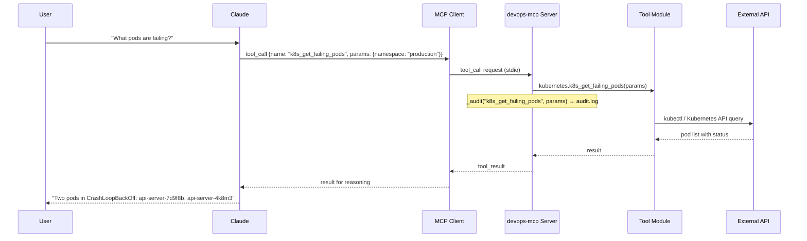
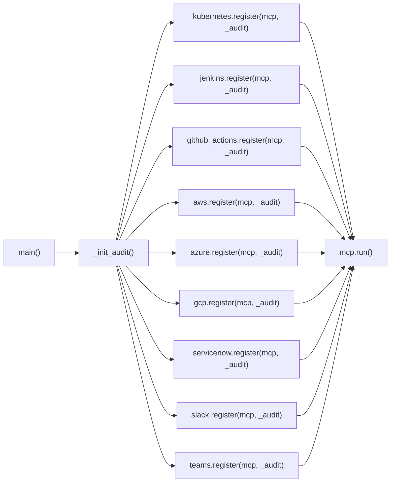
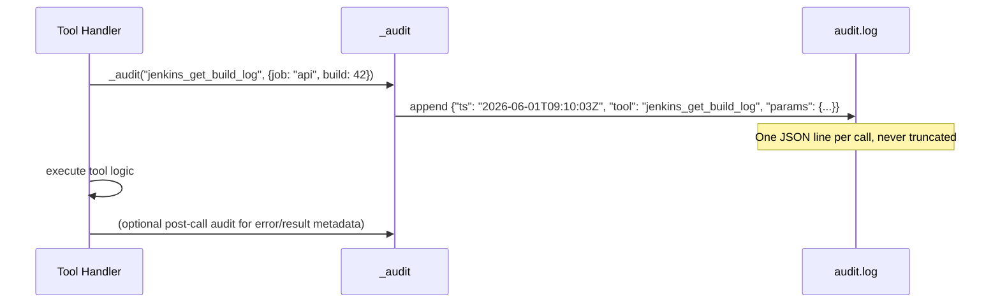
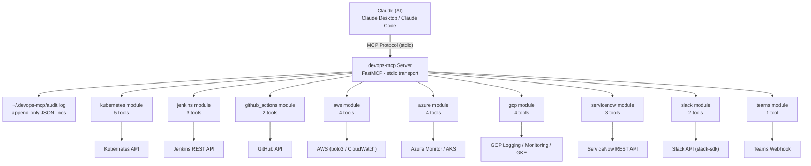

# Architecture: devops-mcp

## Overview

`devops-mcp` is an MCP (Model Context Protocol) server that gives Claude live, read-only access to 9 DevOps tool categories: Kubernetes, Jenkins, GitHub Actions, AWS, Azure, GCP, ServiceNow, Slack, and Microsoft Teams. Claude calls tools on this server the same way it calls any MCP tool — no HTTP wrapper, no separate API layer.

Every tool call is appended to `~/.devops-mcp/audit.log` as a JSON line before the result is returned.

---

## MCP Protocol Flow

---

## Tool Module Registration

Each tool module calls `mcp.tool()` (FastMCP decorator) during `register()` to bind its functions to the server. After all 9 modules register, `mcp.run()` starts the stdio transport loop.

---

## Audit Logging Flow

Audit entries are written before tool execution. The log is append-only and lives at `~/.devops-mcp/audit.log`. It captures timestamp (UTC ISO-8601), tool name, and all parameters — enough to reconstruct who queried what and when.

---

## Component Diagram

---

## Design Decisions

**Why MCP over a REST API?**

> **Interview note:** Claude natively speaks the MCP protocol — it calls `tool_call` messages the same way a function is invoked. Wrapping these tools in a REST API would require a separate HTTP server, auth layer, and client library. MCP eliminates all of that: the server runs as a subprocess over stdio and Claude discovers available tools at startup via `tools/list`.

**Why an audit log?**

> **Interview note:** Every tool call is logged before execution. This satisfies two concerns simultaneously: security (knowing which credentials were exercised and when) and compliance (a tamper-evident append-only record of all queries). It also makes incident post-mortems reproducible — you can replay exactly what Claude queried during an outage.

**Why modular registration (`module.register(mcp, _audit)`)?**

> **Interview note:** This is the Open/Closed Principle in practice. Adding a new integration — say, PagerDuty — means creating one file (`pagerduty.py`) and adding one line (`pagerduty.register(mcp, _audit)`) in `main()`. The server core never changes. Each module owns its own tool definitions, credential checks, and error handling.

**Why FastMCP?**

> **Interview note:** FastMCP is a higher-level wrapper over the base `mcp` SDK. It exposes a `@mcp.tool()` decorator that handles JSON schema generation, input validation, and result serialization automatically. Without it, each tool would require manually constructing `Tool` objects and writing `CallToolResult` serializers — roughly 3x the boilerplate per tool across 28 tools.
